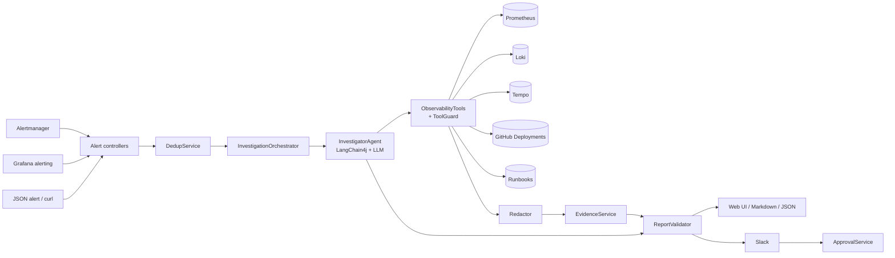

# Moriarty: AI incident investigator

[](https://github.com/takenrohit/Moriarty/actions/workflows/ci.yml)

Moriarty is a Java service that investigates production alerts for on-call engineers. When an
alert arrives, an LLM coordinates a set of read-only tools over metrics, logs, traces, recent
deployments and runbooks, and the service produces an incident report in which every finding cites
the evidence it came from. Java code, not the model, enforces the guardrails: which services and
time ranges may be queried, how many tool calls and tokens an investigation may use, what is
redacted, and whether the report's citations are valid. Risky recommended actions such as a
rollback require human approval and are never executed automatically.

## Features

- Alert intake from Prometheus Alertmanager, Grafana alerting, or a simple JSON alert format.
- Deduplication of repeated alerts by fingerprint (in-JVM lock, or Redis across instances).
- Tool-driven investigation with LangChain4j: metric queries (PromQL), log search (LogQL), problem
  traces, recent deployments with commit and PR details, and runbook lookup.
- Evidence store: every tool result is redacted and stored as evidence with an ID such as
  `ev-inc-1a2b3c4d5e6f-3`; report findings must cite these IDs.
- Report validation against a JSON schema and the stored evidence; one retry with the validation
  errors, then an evidence-only `INCONCLUSIVE` report.
- Reports as JSON, Markdown, a web page, and (optionally) a Slack message.
- Slack approval buttons for risky actions, with signed-request verification. A decision is
  recorded, never executed.
- Report feedback (helpful or unhelpful) and re-investigation that keeps earlier report versions.
- Self-observability: OpenTelemetry spans for investigations, tool calls and LLM calls, Micrometer
  metrics, and a provisioned Grafana dashboard.
- Mock mode with built-in failure scenarios (`payment-gateway`, `bad-deploy`,
  `db-pool-exhaustion`, `noisy-neighbour`), so it runs without any backend.

## Architecture



`ToolGuard` checks every tool call before it reaches a backend. Tool results pass through the
`Redactor` before they are stored or shown to the model. `ReportValidator` rejects drafts that cite
evidence that does not exist or belongs to another incident.

## Tech stack

Java 21, Spring Boot 3.5, LangChain4j 1.x (OpenAI-compatible chat API), Micrometer and
OpenTelemetry, PostgreSQL with Flyway, Redis, Thymeleaf, JUnit 5, Testcontainers, WireMock, and a
Docker Compose stack with Prometheus, Alertmanager, Grafana, Loki, Tempo and the OpenTelemetry
Collector.

## Quick start A: mock mode (no Docker)

Requires JDK 21 and an API key for any OpenAI-compatible chat endpoint. The `mock` profile serves
built-in scenario data and keeps everything in memory.

```bash
cd investigator
cp .env.example .env        # PowerShell: Copy-Item .env.example .env
```

Edit `.env` and set the LLM variables. For OpenAI keep `LLM_BASE_URL=https://api.openai.com/v1`.
For Google Gemini use its OpenAI-compatible endpoint:

```properties
LLM_BASE_URL=https://generativelanguage.googleapis.com/v1beta/openai/
LLM_API_KEY=<your key>
LLM_MODEL=gemini-2.5-flash
LLM_MAX_RETRIES=10          # helps on rate-limited free tiers
```

Spring Boot does not read `.env` by itself, so load it into the shell and start the service:

```bash
set -a; . ./.env; set +a
./mvnw spring-boot:run
```

```powershell
Get-Content .env | Where-Object { $_ -match '^\s*[A-Z_]+=' } | ForEach-Object { $k, $v = $_ -split '=', 2; Set-Item "env:$($k.Trim())" $v.Trim() }
.\mvnw.cmd spring-boot:run
```

Post the demo alert. The optional `scenario` label picks a mock scenario.

```bash
curl -X POST http://localhost:8080/api/v1/alerts \
  -H "Content-Type: application/json" \
  -d '{
        "alert": "HighErrorRate",
        "service": "checkout-api",
        "severity": "critical",
        "detectedAt": "2026-11-23T14:40:00Z",
        "labels": { "environment": "production", "scenario": "payment-gateway" },
        "dashboardLinks": ["http://localhost:3000/d/checkout"]
      }'
```

The response (`202 Accepted`) contains the `incidentId` and a `reportUrl`. Open
<http://localhost:8080/incidents> to follow the investigation and read the report.

## Quick start B: full stack (Docker Compose)

Requires Docker; the containers' memory limits add up to about 5 GB. From the repository root, create
`investigator/.env` as above, then:

```bash
docker compose -f deploy/docker-compose.yml up --build -d
docker compose -f deploy/docker-compose.yml ps
```

The stack runs the investigator with the `real,postgres,redis` profiles, three instrumented mock
services (`checkout-api` → `payment-gateway` → `payment-provider`), a fake GitHub API and the
observability backends. To reproduce the demo incident, record a deploy and then make the payment
provider slow:

```bash
./mock-services/deploy.sh               # PowerShell: .\mock-services\deploy.ps1
curl -X POST "http://localhost:8083/inject/slow?enabled=true&ms=5000"
```

Within a few minutes the `HighErrorRate` rule fires and Alertmanager posts the alert to the
investigator. See [mock-services/README.md](mock-services/README.md) for the full sequence and
options. Turn the fault off with `enabled=false` and stop with `docker compose -f
deploy/docker-compose.yml down`.

| URL | Service |
|-----|---------|
| <http://localhost:8080/incidents> | Investigator web UI |
| <http://localhost:3000> | Grafana (anonymous access, investigator dashboard) |
| <http://localhost:9090> | Prometheus |
| <http://localhost:9093> | Alertmanager |

## API

| Method and path | Purpose |
|-----------------|---------|
| `POST /api/v1/alerts` | Submit an alert in the JSON format above; `202` with the incident ID |
| `POST /api/v1/alerts/alertmanager` | Alertmanager webhook receiver |
| `POST /api/v1/alerts/grafana` | Grafana alerting webhook receiver |
| `GET /api/v1/incidents/{id}` | Incident and investigation status |
| `GET /api/v1/incidents/{id}/report` | Latest report as JSON (`202` while the investigation runs) |
| `GET /api/v1/incidents/{id}/report.md` | Latest report as Markdown |
| `GET /api/v1/incidents/{id}/reports/{version}` | A specific report version |
| `POST /api/v1/incidents/{id}/reinvestigate` | Start a new investigation; `409` if one is running |
| `POST /api/v1/reports/{incidentId}/feedback` | Rate a report: `{"rating": "helpful", "note": "..."}` |
| `GET /api/v1/reports/{incidentId}/feedback` | List feedback for a report |
| `POST /api/v1/slack/interactions` | Slack button callbacks (signature-verified) |
| `GET /incidents`, `GET /incidents/{id}` | Web UI |
| `GET /actuator/health`, `GET /actuator/prometheus` | Health and metrics |

Incident IDs have the form `inc-` followed by 12 lowercase hex digits.

## Configuration

All settings are environment variables; [investigator/.env.example](investigator/.env.example)
documents each one. The main ones:

| Variable | Default | Purpose |
|----------|---------|---------|
| `LLM_BASE_URL` | `https://api.openai.com/v1` | OpenAI-compatible chat completions endpoint |
| `LLM_API_KEY` | (required) | API key for the LLM endpoint |
| `LLM_MODEL` | `gpt-4o-mini` | Model name |
| `LLM_JSON_MODE` | `true` | Request JSON object responses |
| `LLM_MAX_RETRIES` | `2` | Retries on 429/5xx from the LLM |
| `SPRING_PROFILES_ACTIVE` | `mock` | `mock`, or `real` plus optional `postgres`, `redis` |
| `PROMETHEUS_URL`, `LOKI_URL`, `TEMPO_URL` | `localhost` ports | Backends for the `real` profile; blank falls back to mock |
| `GITHUB_API_URL`, `GITHUB_REPOSITORY`, `GITHUB_TOKEN` | fake GitHub | Deployment history |
| `SPRING_DATASOURCE_URL` and related | local defaults | PostgreSQL (`postgres` profile) |
| `REDIS_URL` | `redis://localhost:6379` | Dedup lock and rate limits (`redis` profile) |
| `WEBHOOK_SECRET` | unset | Shared secret required on alert endpoints when set |
| `SLACK_BOT_TOKEN`, `SLACK_CHANNEL_ID`, `SLACK_SIGNING_SECRET` | unset | Slack reports and approvals |
| `INVESTIGATOR_PUBLIC_URL` | `http://localhost:8080` | Base URL for report links in Slack |
| `INVESTIGATOR_DISPLAY_TIMEZONE` | `Asia/Kolkata` | Time zone used in reports |

Limits such as the tool-call budget, the token budget and rate limits are in
`investigator/src/main/resources/application.yml` under `investigator.*`.

## Guardrails

- **Read-only tools.** The model can only call the five query tools; nothing it calls changes a
  system.
- **Scope checks.** `ToolGuard` allows only known services, clamps time ranges to the
  investigation window, and limits query length, lookback and result size.
- **Budgets.** Each investigation has a tool-call limit (15), a timeout (3 minutes) and a token
  budget (200,000 tokens). Tool calls past the limit are refused; the timeout or an exhausted token
  budget ends the investigation as `INCONCLUSIVE`. Tool calls per backend and investigations per
  service are rate-limited (new alerts past the limit get `429`).
- **Redaction.** Emails, card numbers (Luhn-checked), JWTs, bearer tokens, AWS access keys and
  `password=`/`secret=`/`token=` values are replaced before evidence is stored or sent to the LLM.
- **Evidence-cited reports.** Findings must cite existing evidence IDs of the same incident;
  invalid drafts get one corrected retry, then an evidence-only `INCONCLUSIVE` report.
- **Human approval.** Actions other than investigate or escalate (for example rollback, restart,
  traffic shift) are marked as requiring approval. With Slack configured they get Approve/Reject
  buttons; the decision is recorded and nothing is executed.
- **Audit trail.** Alerts, tool calls, LLM exchanges, rejected drafts and reports are recorded;
  with PostgreSQL the application role cannot update or delete audit rows.

## Testing

```bash
cd investigator
./mvnw verify                 # unit, property and integration tests
./mvnw verify -Pllm-eval      # real-LLM evaluation; needs LLM_API_KEY (skipped without it)
```

Integration tests tagged `containers` use Testcontainers (PostgreSQL, Redis, Prometheus) and need
a running Docker daemon. The mock services have their own build: `cd mock-services` and
`./mvnw verify`. CI runs both builds on every push and pull request.

## Project layout

```text
investigator/                 Spring Boot investigator service
  src/main/java/dev/investigator/
    alert/  api/  dedup/      alert intake, REST controllers, deduplication
    investigation/  tools/    orchestrator, LangChain4j agent, tools and ToolGuard
    integration/              Prometheus, Loki, Tempo, GitHub clients and mock scenarios
    evidence/  report/        redaction, evidence store, validation, rendering, Slack, approvals
    audit/  store/  feedback/ audit trail, repositories, report feedback
    observability/  ratelimit/  web/
  src/main/resources/         application*.yml, prompts, runbooks, report schema, Flyway migrations
mock-services/                instrumented demo services and deploy scripts
deploy/                       Docker Compose stack and backend configuration
.github/workflows/ci.yml      CI build
```
